# Project Infinity-X 4.1 for Redmi 13 5G / POCO M6 Plus 5G (`breeze`)

<div align="center">


### Official Local Manifest & Build Guide for `breeze` / `breezein`
**Maintainer**: Wanderer &bull; **Variant**: Pure Vanilla (`WITH_GAPPS=false`) &bull; **Android Version**: 17 (UpsideDownCake)

</div>

---

## 📋 Table of Contents
1. [Overview](#-overview)
2. [Step-by-Step Cloning & Sync Procedure](#-step-by-step-cloning--sync-procedure)
3. [Building the ROM](#-building-the-rom)
4. [Does Upstream Still Work? (Upstream Architecture)](#-does-upstream-still-work)
5. [Repositories Included in this Manifest](#-repositories-included-in-this-manifest)

---

## 🔍 Overview
This repository provides the local manifest (`breeze.xml`) for **Project Infinity-X 4.1**. It automatically binds:
* Device tree, kernel, vendor blobs, and hardware HALs for `breeze`.
* Customized Wanderer apps (Local ZIP Updater, Hardware Card in Settings, Cellular Data QS Dialog).
* Private release signing keys.

---

## 🚀 Step-by-Step Cloning & Sync Procedure

Follow this exact procedure on any fresh build server or workstation:

### 1. Set Up Environment & Repo Tool
Ensure you have `git`, `repo`, and build tools installed:
```bash
sudo apt update && sudo apt install -y git-core gnupg flex bison build-essential zip curl zlib1g-dev libc6-dev-i386 libncurses6 libncurses-dev x11proto-core-dev libx11-dev lib32z1-dev libgl1-mesa-dev libxml2-utils xsltproc unzip fontconfig python3 rsync
```

### 2. Initialize the Infinity-X 17 Source Tree
Create your workspace directory and initialize the upstream Project Infinity-X 17 manifest:
```bash
mkdir -p ~/infinity && cd ~/infinity
repo init --depth=1 --no-repo-verify -u https://github.com/ProjectInfinity-X/manifest -b 17
```

### 3. Clone This Local Manifest
Clone this repository directly into `.repo/local_manifests`:
```bash
git clone https://github.com/Wanderer-s-Development/infinityx_android_local_manifests.git .repo/local_manifests
```

### 4. Sync the Entire Source Tree
Run the high-speed parallel sync command:
```bash
repo sync -c --no-clone-bundle --no-tags --optimized-fetch --prune -j$(nproc)
```

> [!TIP]
> **Authentication for Private Keys**:  
> To clone your private keys (`infinityx_vendor_infinity_keys`), ensure your SSH key is added to your GitHub account or repository deploy keys before running `repo sync`.

---

## 🔨 Building the ROM

Once `repo sync` finishes, compile the signed Vanilla Release build with:

```bash
cd ~/infinity

# 1. Source build environment
source build/envsetup.sh

# 2. Set build flags
export INFINITY_MAINTAINER="Wanderer"
export INFINITY_BUILD_TYPE="RELEASE"
export WITH_GAPPS=false
export TARGET_BUILD_VARIANT=user

# 3. Lunch for breeze
lunch infinity_breeze-user

# 4. Compile bacon (full flashable ZIP and recovery image)
m bacon -j$(nproc)
```

Your flashable package and recovery will be generated at:
```
out/target/product/breeze/Project_Infinity-X-4.1-*-RELEASE-VANILLA-breeze.zip
out/target/product/breeze/recovery.img
```

---

## 🔄 Does Upstream Still Work?

### **YES — 100%. Upstream sync works seamlessly.**

Here is how the architecture handles upstream updates:

```mermaid
flowchart TD
    subgraph Upstream_AOSP["1. AOSP & Lineage Upstream (1,216 repos)"]
        direction TB
        AOSP["Google AOSP Base (1,067 repos)"]
        LineageHALs["LineageOS CAF HALs & Drivers (149 repos)"]
    end

    subgraph Upstream_Infinity["2. Project Infinity-X Upstream (50+ repos)"]
        direction TB
        ThemePicker["ThemePicker & Themes"]
        Launcher["Launcher3 & QuickStep"]
        SystemServices["System core, vold, sepolicy"]
    end

    subgraph Wanderer_Org["3. Your Organization (Wanderer-s-Development)"]
        direction TB
        DeviceTree["infinityx_device_xiaomi_breeze"]
        Updater["infinityx_packages_apps_Updater"]
        Settings["infinityx_packages_apps_Settings"]
        Suite["infinityx_packages_apps_InfinitySuite"]
        Vendor["infinityx_vendor_infinity"]
        Keys["infinityx_vendor_infinity_keys"]
    end

    RepoSync["repo sync -j$(nproc)"]
    
    RepoSync -->|Pulls latest upstream commits automatically| Upstream_AOSP
    RepoSync -->|Pulls latest upstream features automatically| Upstream_Infinity
    RepoSync -->|Pulls your custom patches & configs| Wanderer_Org
```



### Key Upstream Guarantees:
1. **1,260+ repositories sync directly from upstream**: Whenever Google or LineageOS patches security vulnerabilities or upstream Infinity-X adds features, a simple `repo sync` pulls them automatically.
2. **Your forks stay in sync with 1 command**: For your 4 customized forks (`Settings`, `Updater`, `InfinitySuite`, `vendor_infinity`), whenever upstream Project Infinity-X releases updates, you can merge them effortlessly:
   ```bash
   cd packages/apps/Settings
   git fetch https://github.com/ProjectInfinity-X/packages_apps_Settings.git 17
   git merge FETCH_HEAD
   git push wanderer 17
   ```

---

## 📦 Repositories Included in this Manifest

| Path | Repository | Purpose |
| :--- | :--- | :--- |
| `vendor/infinity-priv/keys` | [`infinityx_vendor_infinity_keys`](https://github.com/Wanderer-s-Development/infinityx_vendor_infinity_keys) | 🔒 Private release signing keys |
| `device/xiaomi/breeze` | [`infinityx_device_xiaomi_breeze`](https://github.com/Wanderer-s-Development/infinityx_device_xiaomi_breeze) | Device tree (assertions, lunch, props) |
| `device/xiaomi/breeze-kernel` | `Niyush-04/device_xiaomi_breeze-kernel` | Prebuilt kernel & vendor ramdisk |
| `vendor/xiaomi/breeze` | `Niyush-04/vendor_xiaomi_breeze` | Proprietary vendor blobs |
| `hardware/xiaomi` | `LineageOS/android_hardware_xiaomi` | Lineage Xiaomi hardware interfaces |
| `packages/apps/Updater` | [`infinityx_packages_apps_Updater`](https://github.com/Wanderer-s-Development/infinityx_packages_apps_Updater) | 1MB streaming buffer, local ZIP import |
| `packages/apps/InfinitySuite` | [`infinityx_packages_apps_InfinitySuite`](https://github.com/Wanderer-s-Development/infinityx_packages_apps_InfinitySuite) | Cellular data dialog setting switch |
| `packages/apps/Settings` | [`infinityx_packages_apps_Settings`](https://github.com/Wanderer-s-Development/infinityx_packages_apps_Settings) | Snapdragon 4 Gen 2 AE hardware card |
| `vendor/infinity` | [`infinityx_vendor_infinity`](https://github.com/Wanderer-s-Development/infinityx_vendor_infinity) | Wanderer release flags & backuptool |

---

<div align="center">
Maintained with ❤️ by <b>Wanderer</b>
</div>
